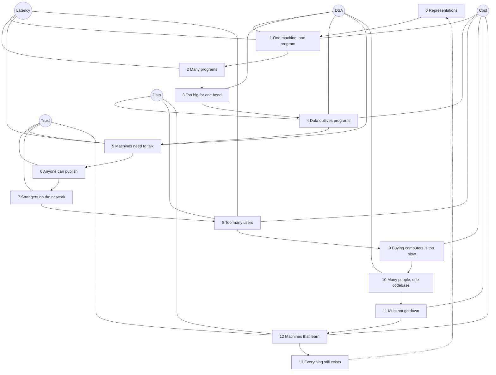

# Throughline

Last reviewed: 2026-10-24

Computing has solved the same few problems again and again, each time under different limits: hardware, money, law, what users expect. This wiki tells those problems as stories, in the order they appeared, so you learn what carries forward and what was only a detail of its era. It's a launchpad, not a course: one short page per problem, one mental model that grows a few sentences at a time, and links outward for depth.

Most of the stories are a well-considered decision that later caused a problem, and the trip back to the drawing board. That loop is the job.

## The lens

Four questions, implied on every page:

1. **What do we have?** Data, and its dimensions: shape, size, location, velocity, trust, cost to obtain.
2. **What can we do with it?** Store, move, transform, find, decide, show, protect.
3. **How, and within what limits?** The ladder of means, from hand-built to rented. Some limits are physical or economic; some are policy or law.
4. **Why?** The chain from data to someone's outcome. The why moves, and it also runs backwards: what users come to expect at the screen pulls new practice into the backend.

When you're out of your depth, with a colleague or with Claude Code, the same four make the question: *I have this data, I want this verb, what are the means, and which limit will bind?*

## Reading order

Read the trunk in order. Or start at the page you already know best and follow its Connections to what you don't.

| # | Problem |
| --- | --- |
| 0 | [Humans need representations before they need machines](00-representations.md) |
| 1 | [One machine, one program](01-one-machine-one-program.md) |
| 2 | [One machine, many programs](02-one-machine-many-programs.md) |
| 3 | [Programs too big for one head](03-programs-too-big-for-one-head.md) |
| 4 | [Data outlives programs](04-data-outlives-programs.md) |
| 5 | [Machines need to talk](05-machines-need-to-talk.md) |
| 6 | [Anyone can publish](06-anyone-can-publish.md) |
| 7 | [Strangers on the network](07-strangers-on-the-network.md) |
| 8 | [Too many users, too much data](08-too-many-users-too-much-data.md) |
| 9 | [Buying computers is too slow](09-buying-computers-is-too-slow.md) |
| 10 | [Many people, one codebase](10-many-people-one-codebase.md) |
| 11 | [Software that must not go down](11-software-that-must-not-go-down.md) |
| 12 | [Machines that learn from data](12-machines-that-learn-from-data.md) |
| 13 | [Everything still exists at once](13-everything-still-exists-at-once.md) |

Alongside the trunk:

- [The model](the-model.md): the finished mental model. If you're experienced, find the sentence you doubt and go to its page.
- [Forces](forces.md): the non-technical limits (money, law, distribution) that moved the field as much as hardware did.
- [Pushback](pushback.md): questions for when a solution arrives before its problem.

Links to pages that don't exist yet are deliberate. They're the branches nobody has written, and they're how this grows.

## The map

The circles are the hubs: ideas every few pages come back to.

## Honesty rules

- If a winner won by luck or timing, say so. Don't invent a rationale afterwards.
- Separate the reason given from the likely reason. Engineering blogs are marketing, postmortems are edited, and talks flatter the speaker. We link them anyway and say so.
- Name the money: who paid, who profited, and what that did to the technology.
- Say "we don't know" when we don't.
- Don't grade the past by today's knowledge. Most "mistakes" were reasonable under the limits of their time, and that's the point of the stories.

## Contributing

Anyone may edit. The design is in [SPEC.md](SPEC.md). Changes to the model need review from one other person, because the model is what everyone carries. Every page has a `Last reviewed` date, because this wiki drifts too.

To track your own reading, keep a `progress.md` in your clone. It's gitignored, so the repo tracks no one's progress.
