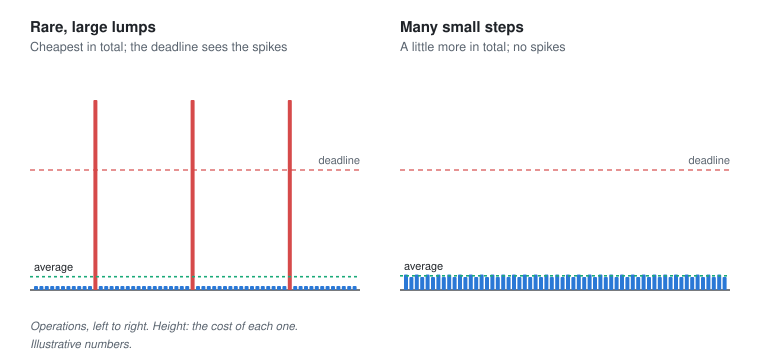

# Amortised cost

Last reviewed: 2026-11-12

A concept page: some operations are cheap almost every time and occasionally very expensive, so that the average is excellent and one moment in a thousand is terrible. Amortised cost is the average over a long run. Whether it's the number that matters depends on who is waiting during the expensive moment.

## Problem

Many of the best techniques in computing work by paying occasionally: a list that doubles its space when full, a hash table that rebuilds itself, a garbage collector that tidies memory every so often, a database that merges its files in the background. Averaged over many operations, each one is cheap, often cheaper than any alternative. But the bill still arrives, all at once, at some moment nobody chose. For a batch job, that's fine. For something that must answer within a deadline, the average is the wrong number to look at.

## The story

In 2018 Henrike Vos led the team behind an advertising auction service in Amsterdam. Every time someone opened a page on a partner's website, the service received a request: who is this, what are they reading, how much will you bid to show them an advert? It had to answer within a hundred milliseconds, or the auction went ahead without it. The team wrote the service in a language with automatic memory management. Nobody had to free memory by hand, a whole class of crashes couldn't happen, and the team could build features quickly. Average response time was two milliseconds.

To bid well, the service needed to remember things about the people it saw, so the team kept a large cache in memory: tens of millions of small records, each linked to a few others. It made bids smarter, and the revenue graph went up. They made the cache bigger, and it went up again.

Then the finance team noticed that the service was losing a few per cent of auctions it should have won, always in bursts. Henrike looked at the response times. The average was still two milliseconds. But every couple of minutes, for about a third of a second, every request took longer than a hundred milliseconds, and all of them were too late. It was the garbage collector. Every so often it had to look through memory to find what was no longer used, and the larger and more tangled the cache became, the longer each look took. The collector was doing exactly what it was designed to do: a little memory management on every request, on average, paid for in occasional large lumps. The service had made each lump bigger every time it grew the cache.

*Before reading on: the average was excellent, and the revenue was leaking out through one moment every two minutes. What would you have changed?*

Henrike stopped looking at the average and started looking at the slowest one request in a thousand, because that was what decided whether the service missed auctions. Then the team made the occasional cost smaller, rather than the usual cost. The cache moved out of the collector's way: into one large block of memory the collector didn't need to inspect piece by piece, holding plain records instead of millions of small linked objects. The collector's work shrank to the short-lived things each request created. They tuned it to do its work in many small steps instead of a few big ones, accepting slightly more work on average for much shorter pauses. Buffers the hot path used were allocated once at start-up and reused. The slowest requests dropped below twenty milliseconds, and the bursts of lost auctions stopped.

Looking back, Henrike thought amortised cost was an honest promise that she'd read as a different one. It promised that the total was cheap. It didn't promise that every moment was cheap, and the service's customers only ever experienced moments. The question to ask of any clever average was who would be waiting when the bill came due.

*The same average, paid in rare large lumps or in many small steps. A deadline only cares about the lumps.*

## Where it shows up

| Page | What was paid occasionally | Who was waiting when it came |
| --- | --- | --- |
| [Hash tables](hash-tables.md) | Kenji's table doubling and moving every entry | Every player in the game, for a noticeable pause. |
| [LSM trees](lsm-trees.md) | Neha's background merging of small files into large ones | Reads, which slowed while the merges competed for the disk. |
| [Distributions and percentiles](../math/percentiles.md) | The slow tail of response times | The users in the tail, whom the average describes as fine. |
| [Event loops and threads](../runtimes/event-loops-and-threads.md) | One long piece of work on the single loop | Every other request, stuck behind it. |
| [Queueing](../latency/queueing.md) | A burst arriving at a busy server | Everyone in the queue behind the burst. |

It shows up elsewhere too: lists in most languages that grow by doubling, databases rebuilding statistics or indexes, log files rotated and compressed once a day, nightly batch jobs, a team that saves all its clean-up for one week a year, and the monthly bill that arrives for a month of small decisions.

What these share is a trade between frequent small costs and rare large ones with the same or lower total. Rare and large is usually cheaper overall. It's only acceptable when nobody is waiting on any single moment, and it needs the worst moment measured, not the average.

Motif: [costs move; they don't disappear](../motifs.md#costs-move-they-dont-disappear).

## It really happened

Henrike is fictional. Robert Tarjan set out amortised analysis formally in 1985, in "Amortized Computational Complexity", as a way to prove that operations which are occasionally expensive are cheap over any long sequence. The growable array is the textbook case: doubling the space each time it fills means each element is copied, on average, only about once more, so adding to the end costs a constant amount on average, while a single addition can cost a copy of everything. Growing by a fixed amount instead makes the total copying grow with the square of the size.

In 2020 Discord explained why it had rewritten one of its services, the one that tracks which messages each user has read, from Go into Rust. The service kept a large cache in memory, and the Go runtime of the time forced a garbage collection at least every two minutes, which had to scan the whole cache. Response times spiked every two minutes as a result. Rust has no garbage collector, and the spikes went away ([Discord, "Why Discord is switching from Go to Rust"](https://discord.com/blog/why-discord-is-switching-from-go-to-rust)). Go's collector has improved a great deal since, which is a reminder that these costs belong to particular versions as well as particular designs.

## What it is

The amortised cost of an operation is its total cost over a long sequence of operations divided by their number. It can be low even when individual operations are occasionally very expensive, as with dynamic arrays that double, hash tables that resize, garbage collection and compaction. Amortised bounds describe throughput, not latency. When a single slow operation matters, because of a deadline, a user waiting or a lock held, look at the worst case and the high percentiles too, and consider spreading the expensive work out (incremental resizing or collection), doing it in advance (preallocating), or moving it off the critical path.

## Where it gets misapplied

- **Judging a service by its average.** Henrike's two milliseconds, with a third of a second every two minutes hidden inside it.
- **Growing by a fixed amount.** Adding a thousand slots each time a list fills turns a cheap operation into a quadratic one; growing by a factor keeps it cheap on average.
- **Making the rare cost bigger without noticing.** A cache that grows makes every garbage collection that has to scan it longer.
- **The mirror:** removing every occasional cost from a batch job nobody waits on. Doing the work in small steps costs more in total; it's only worth it when a single moment matters.

## Connections

- Learning this is also learning [growth](growth.md), because amortised analysis is how a cost that's sometimes linear can still grow as a constant per operation.
- Learning this is also learning [hash tables](hash-tables.md), because their doubling is the most familiar amortised cost, and Kenji's pause is what it feels like.
- Learning this is also learning [distributions and percentiles](../math/percentiles.md), because the occasional expensive moment lives in the tail, where averages don't look.
- Learning this is also learning [LSM trees](lsm-trees.md), because they make writes cheap now by agreeing to merge later.
- Learning this is also learning [event loops and threads](../runtimes/event-loops-and-threads.md), because an expensive moment on a single loop is paid by everyone waiting on it.

## Resources

1. Discord, ["Why Discord is switching from Go to Rust"](https://discord.com/blog/why-discord-is-switching-from-go-to-rust) (2020) (start here: a real service, with the graph of its spikes).
2. Thomas Cormen and others, *Introduction to Algorithms*, the chapter on amortised analysis (go deeper: the three standard methods, with the growable array).
3. Robert Tarjan, "Amortized Computational Complexity", *SIAM Journal on Algebraic and Discrete Methods* (1985) (reference).

## Names you'll hear

- **Amortised cost:** the average cost per operation over a long run.
- **Dynamic array, growth factor:** a list that reallocates when full, and how much bigger it gets each time.
- **Garbage collection, stop-the-world pause:** automatic memory reclamation, and the moments it halts the program to do it.
- **Incremental, concurrent:** doing occasional work in small steps, or alongside the program.
- **Tail latency, p99.9:** the slow end of response times, where amortised costs show up.

## Go and look

Find a graph of response times for something you run, and look at its slowest one in a thousand rather than its average. If it spikes at regular intervals, look for something that runs on a timer or when a buffer fills.
