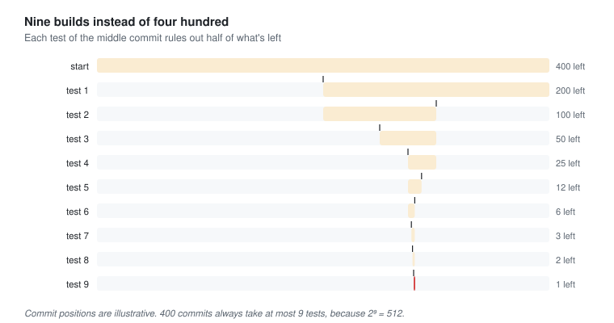

# Divide and conquer

Last reviewed: 2026-11-12

A concept page: split a problem into smaller ones of the same kind, solve those, and combine the answers. It's how binary search, merge sort and most big data processing work, and it's how people divide large projects too. The splitting is the obvious part; the combining is where the thought has to go.

## Problem

Some problems are too big to solve in one go: too much data for one machine, too many possibilities to check one by one, too much code for one person. Splitting them helps only when the pieces are independent enough to solve separately, and when their answers can be put back together correctly. When either fails, splitting makes things slower or quietly wrong.

## The story

In 2010 Kwesi Boateng was the release engineer at a company in Accra that made accounting software for small businesses. One Monday the nightly build, which had passed on Friday, produced invoices with the tax added twice. Since Friday, four hundred commits had gone in. Every build and test run took twenty minutes. Kwesi did the careful thing: start from Friday's good version, add the commits one at a time, and test after each, so the first one that failed would be the culprit. It was methodical and certain to find it. It would also take up to five days.

A colleague leaned over and suggested testing the commit halfway through instead. If the middle one was bad, the culprit was in the first half; if it was good, the second. Either way two hundred commits could be ignored. Then halve again. Kwesi ran it by hand: the middle, then the middle of the half that was left, and so on. Nine builds, three hours, and he had the commit, a one-line change to rounding that had been reviewed and looked harmless. The version-control system, he discovered later that year, could do the halving for him.

The idea stayed with him. In 2012 his team was asked for a report the finance department wanted every month: how many different customers had used each product, out of a year of usage logs. On one machine the job took thirty hours. Kwesi split it the same way. The year's logs were divided by day across fifty machines, each one counted the different customers it saw in its day for each product, and a final step added the fifty answers together. It ran in forty minutes. He was proud of it for a month.

Then someone in finance compared the report with the billing system. The number of different customers for the main product was three times what billing showed. Kwesi checked each machine's answer, and every one was right. The mistake was in the combining. A customer who used the product on twenty different days had been counted, correctly, by twenty different machines, and then the twenty counts were added. Counts of *different* customers don't add up across days.

*Before reading on: every piece was solved correctly, and the combined answer was wrong. What would you have changed?*

Kwesi went back to the three parts of the method: split, solve, combine. He'd thought hard about the first two and taken the third for granted. Some answers combine by adding: total sales, total minutes, the number of log lines. Some don't, and the number of different customers is the classic one. There were two ways to fix it. He could change the split, so that all of one customer's records went to the same machine, by customer instead of by day; then each machine's set of customers was separate from the others', and adding *did* give the right total. Or he could change what each machine handed back: the list of customer IDs it had seen, not just how many, so the combining step could merge the lists and count each customer once. He chose to split by customer. It took a day to rewrite, the report matched billing, and he added a line to the team's checklist for every split job: *What does each piece return, and does combining those answers give the right answer for the whole?*

Looking back, Kwesi thought the halving had been the easy lesson. Splitting a problem was natural; anyone could see that half of four hundred was two hundred. What had nearly fooled the finance department was the step nobody drew on the whiteboard: putting the pieces back together. A problem was only divisible if its answer was.

*Kwesi's nine builds: each test of the middle commit ruled out half of what was left.*

## Where it shows up

| Page | What was split | How the answers were combined |
| --- | --- | --- |
| [Sorting](sorting.md) | Margit's records, around a pivot or into runs | Merge sort merges sorted halves; quicksort needs no combining at all, because the split did the work. |
| [Information gain](../info/information-gain.md) | The possibilities still left | Each answer rules out half of them: the halving behind binary search and Kwesi's nine builds. |
| [Partitioning](../data/partitioning.md) | Sam's data, across machines by key | Choosing the key decides which questions can be answered on one machine and which need all of them. |
| [3, Programs too big for one head](../03-programs-too-big-for-one-head.md) | Elena's system, among six people | Divided by decision, so each piece could change without the others: divide and conquer for people. |
| [Dynamic programming](dynamic-programming.md) | A problem whose pieces overlap | When the same smaller problem comes up again and again, solve it once and remember it. |

It shows up elsewhere too: MapReduce and the data-processing tools that followed it, `git bisect`, binary search in every sorted list and index, fast multiplication of very large numbers, rendering a scene by splitting it into tiles, and any large project divided into teams.

What these share is the three-part shape: split into smaller problems of the same kind, solve each, combine. The split decides whether the pieces are independent. The combine decides whether the answer is right. Most mistakes are in the part nobody thought about.

## It really happened

Kwesi is fictional. Binary search is old and deceptively hard to get right. Donald Knuth noted that although the idea was described in the 1940s, the first version that worked for every list size wasn't published until 1962, and Jon Bentley found that most professional programmers couldn't write a correct one. In 2006 Joshua Bloch reported that the binary search in Java's own library, which he had written, and many others, broke on very large arrays. Calculating the middle as the average of the two ends could add two large numbers past the largest integer the language could hold ([Bloch, "Nearly All Binary Searches and Mergesorts are Broken"](https://research.google/blog/extra-extra-read-all-about-it-nearly-all-binary-searches-and-mergesorts-are-broken/)).

In 2004 Jeffrey Dean and Sanjay Ghemawat described MapReduce, Google's system for running divide-and-conquer jobs across thousands of machines: a *map* step that works on each piece separately, and a *reduce* step that combines the results for each key. The programmer wrote the two functions, and the system handled splitting, failures and moving data. Its design is Kwesi's lesson built in: the reduce step receives every value for a given key together, so the combining can be done correctly.

## What it is

Divide and conquer solves a problem by splitting it into smaller subproblems of the same kind, solving them (often recursively, by the same method), and combining their solutions. Binary search splits and discards half; merge sort splits, sorts and merges; quicksort does its work in the split. The cost depends on how many pieces, how big they are, and how expensive the combining is. It works when subproblems are independent; when they overlap, dynamic programming is usually better. In distributed systems, the split is a partitioning decision, and the combine has to respect what the answers mean: sums and maximums combine simply, counts of distinct items and medians don't.

## Where it gets misapplied

- **Combining answers that don't combine.** Kwesi's distinct customers, added across days. Averages of averages and medians of medians are the same trap.
- **Splitting work whose pieces depend on each other.** Pieces that need each other's results wait or repeat each other's work.
- **Splitting when the overhead is bigger than the work.** Fifty machines for a job that takes a second on one spends most of its time coordinating.
- **The mirror:** never splitting. Testing four hundred commits one at a time is careful, and a hundred times slower than it needs to be.

## Connections

- Learning this is also learning [sorting](sorting.md), because merge sort and quicksort are the two classic ways to divide and conquer an unordered list.
- Learning this is also learning [information gain](../info/information-gain.md), because halving is the question that rules out the most each time.
- Learning this is also learning [partitioning](../data/partitioning.md), because splitting data across machines is a divide-and-conquer decision about which questions stay cheap.
- Learning this is also learning [dynamic programming](dynamic-programming.md), because it's what to do when the pieces overlap instead of standing apart.
- Learning this is also learning [growth](growth.md), because halving is why binary search grows only with the logarithm of the size, and splitting is why the good sorts grow as n log n.

## Resources

1. [VisuAlgo, sorting](https://visualgo.net/en/sorting) (start here: watch merge sort split and combine). <!-- verify -->
2. Jeffrey Dean and Sanjay Ghemawat, ["MapReduce: Simplified Data Processing on Large Clusters"](https://research.google/pubs/mapreduce-simplified-data-processing-on-large-clusters/) (2004) (go deeper: divide and conquer across thousands of machines). <!-- verify -->
3. Jon Bentley, *Programming Pearls*, the column on binary search (reference: why the simplest version is so easy to get wrong).

## Names you'll hear

- **Recursion:** a method that solves a problem by calling itself on smaller versions of it.
- **Binary search, bisection:** finding something by repeatedly halving where it could be.
- **MapReduce, map and reduce:** working on pieces separately, then combining by key.
- **Base case:** the smallest version, solved directly, where the splitting stops.
- **Embarrassingly parallel:** a problem whose pieces need no combining beyond collecting them.

## Go and look

Next time something broke between a good version and a bad one, try `git bisect` instead of reading the history. Then find a report in something you run that adds up numbers from separate pieces, and check whether those numbers really add.
