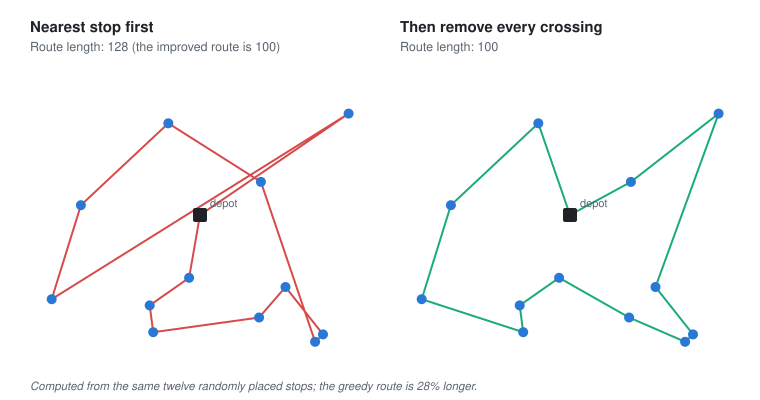

# Greedy algorithms

Last reviewed: 2026-11-12

A concept page: build an answer by always taking the step that looks best right now, and never going back. It's fast and simple, and for some problems it's provably perfect. For others it walks confidently into a corner, and the skill is knowing which kind of problem you have.

## Problem

Many problems are about choosing in sequence: which stop to drive to next, which job to run next, which coins to hand back. Considering every possible sequence is usually far too slow. The obvious shortcut is to make each choice on its own merits, taking the nearest, the shortest or the biggest, and move on. Sometimes the best local choice is always part of the best overall answer. Sometimes it locks you out of a much better one later, and the result looks reasonable enough that nobody checks.

## The story

In 2012 Tunde Bakare wrote the routing software for a courier company in Lagos. Every morning each rider was given thirty or forty parcels, and the software had to put the stops in order. Checking every possible order was out of the question: for thirty stops there were more orders than there are atoms in the Earth. Tunde used the rule any rider would use: from wherever you are, go to the nearest stop you haven't visited yet. It ran instantly, the routes looked sensible on the map, and riders liked that it never sent them backwards across town for the next parcel.

After two months the operations manager brought him a printout. The company's most experienced rider had been given the software's route one day and his own order the next, for the same neighbourhood and a similar set of parcels. His own route was about a fifth shorter. Tunde laid the software's route on a map and saw what the rider had seen. The early part of the day was beautifully efficient: each stop close to the last. Then, with most of the nearby parcels delivered, the remaining stops were scattered at the far edges of the area, left behind because each had never been the nearest at any moment. The route ended with long rides between them, crossing over its own earlier path. Every individual choice had been the best available. Together they had left the worst parts for last.

*Before reading on: every step was the best one available at the time, and the whole route was worse than a rider's. What would you have changed?*

Tunde kept the nearest-stop rule as a starting point, because it was fast and rarely terrible. Then he added a second stage that looked at the whole route. Wherever two legs of the route crossed each other, reversing the stretch between them removed the crossing and always made the route shorter. The program repeated this until no improvement was left, which took a fraction of a second for forty stops. The routes came out close to the experienced riders' and sometimes better.

He also learned where his greedy rule had been right all along. The same company's dispatch screen used a greedy rule to find the fastest way across town between two depots: always extend the shortest route found so far. That one was provably correct, because travel times can't be negative, so a route that's shortest now can never be beaten later. The difference wasn't how clever the rule was. It was whether a choice made now could ever block a better one later.

Looking back, Tunde thought a greedy choice was a bet that the future wouldn't make it look foolish. Sometimes the structure of the problem guaranteed the bet would pay, and then greedy was the best algorithm there was. Sometimes it didn't, and then greedy made a good first draft and a bad final answer.

*The same twelve stops: nearest-first, then with the crossings removed.*

## Where it shows up

| Page | The greedy choice | Did it work? |
| --- | --- | --- |
| [Graphs](graphs.md) | Ruth's shortest path, always extending the nearest junction | Yes, provably, because distances can't be negative. |
| [Computability](computability.md) | The shortest route through many cities | No known method is both exact and fast; greedy rules and improvements are what's actually used. |
| [Queues](queues.md) | Yusuf's short interactive jobs served first | Waiting falls on average, and long jobs can starve unless something guarantees them a turn. |
| [Information](../info/information.md) | Morse's shortest codes for the commonest letters | A greedy idea Huffman later made exact: repeatedly merging the two rarest symbols gives provably the shortest codes. |
| [Dynamic programming](dynamic-programming.md) | Problems where a choice now can block a better one later | The alternative: keep every candidate answer until you know which is best. |

It shows up elsewhere too: making change with coins (fine in most currencies, and wrong in Britain's old one, where greedy paid 48 pence as a half-crown, a shilling and a sixpence when two florins would do), scheduling meetings into rooms, packing boxes into a van, loading balancers sending each request to the least-busy server, and promotion decisions made on last quarter's numbers.

What these share is a bet that the best step now is part of the best answer overall. Some problems guarantee it, and greedy is then optimal and fast. Others don't, and greedy gives a quick, plausible answer that's worth improving before anyone relies on it.

## It really happened

Tunde is fictional; both of his greedy rules are classics. Edsger Dijkstra designed his shortest-path algorithm in 1956, by his own account in about twenty minutes, sitting at a café in Amsterdam with his fiancée, to demonstrate a new computer to a non-specialist audience. He published it in 1959 ([Gries's history, Cornell](https://courses.cs.cornell.edu/cs2110/2017sp/online/shortestPath/01shortestPathHistory.pdf) <!-- verify -->). David Huffman, a graduate student at MIT, found the greedy construction of optimal prefix codes in 1951 as a term paper, after his professor, Robert Fano, offered it as an alternative to the final exam; it was published in 1952.

The delivery problem is the travelling salesman problem, one of the most studied problems in computing. No method is known that finds the shortest route quickly for every case, which is why real routing software combines a fast greedy start with improvements like Tunde's crossing removal, the "2-opt" move described by G. A. Croes in 1958.

## What it is

A greedy algorithm builds a solution step by step, at each step choosing the option that looks best by a local rule, and never revisits a choice. It's correct when the problem has the greedy-choice property (some optimal solution includes the greedy first choice) and optimal substructure (what remains is a smaller problem of the same kind). Dijkstra's algorithm, Huffman coding, minimum spanning trees and scheduling by earliest finishing time are provably optimal greedy algorithms. Where greedy isn't provably optimal, it's often a good heuristic, a fast first answer to be improved by local search such as 2-opt, or bounded by an approximation guarantee.

## Where it gets misapplied

- **Assuming the best step is part of the best route.** Tunde's nearest stops, which saved the scattered ones for last.
- **Trusting greedy because its output looks reasonable.** The only way to know is to compare it with something better, even once.
- **Greedy promotions, greedy cuts, greedy roadmaps.** Organisations make greedy choices too, and the same corners appear.
- **The mirror:** reaching for an exact method when greedy is provably optimal. Dijkstra's algorithm doesn't need a table of every route; the greedy rule is the right answer.

## Connections

- Learning this is also learning [graphs](graphs.md), because Dijkstra's shortest paths and minimum spanning trees are greedy algorithms that are provably right.
- Learning this is also learning [dynamic programming](dynamic-programming.md), because it's what to use when a greedy choice can block a better one later.
- Learning this is also learning [computability](computability.md), because the travelling salesman problem is where greedy rules and approximations exist because exact answers don't come fast.
- Learning this is also learning [compression](../info/compression.md), because Huffman's codes, used inside many compressed formats, are built greedily and are provably the shortest possible.
- Learning this is also learning [queues](queues.md), because "shortest job first" is a greedy rule that's excellent on average and unfair at the edges.

## Resources

1. [VisuAlgo, minimum spanning tree and shortest paths](https://visualgo.net/en/mst) (start here: watch two greedy algorithms that are provably right). <!-- verify -->
2. Jon Kleinberg and Éva Tardos, *Algorithm Design*, the chapter on greedy algorithms (go deeper: how to prove a greedy rule correct, or find where it fails).
3. William Cook, *In Pursuit of the Traveling Salesman* (2012) (reference: the history of the delivery problem, readable).

## Names you'll hear

- **Greedy choice property:** a best first step is always part of some best overall answer.
- **Heuristic:** a rule that usually gives a good answer, with no guarantee.
- **Nearest neighbour, 2-opt:** the greedy route, and the improvement that removes crossings.
- **Huffman coding, Dijkstra's algorithm, minimum spanning tree:** famous greedy algorithms that are provably optimal.
- **Travelling salesman problem:** finding the shortest route through many stops, for which no fast exact method is known.

## Go and look

Find a rule in something you run that picks "the best one now": the least-busy server, the cheapest supplier, the nearest warehouse. Ask whether a choice it makes now could make a later choice worse, and whether anyone has ever compared its results with a better plan.
