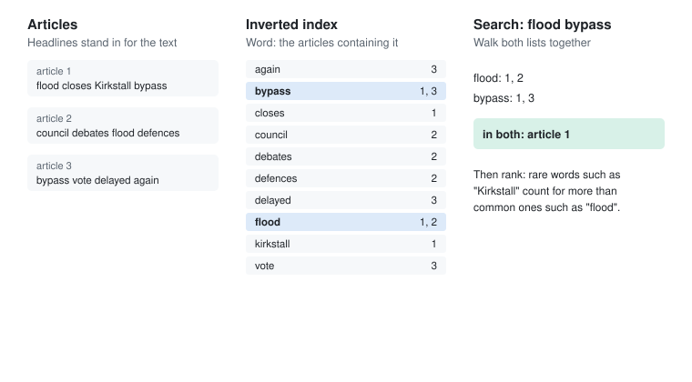

# Search

Last reviewed: 2026-11-12

A concept page: finding what someone is looking for, among more than they could ever read. Each famous technique, from reading everything to inverted indexes and ranking, is the answer to a different version of the question, and the version keeps changing as the collection grows and the people asking change what they want.

## Problem

Every system eventually has to **find** things in a collection too big to look through by hand. At first, "find" means "show me the items containing this", and the challenge is speed. Then the collection grows until there are thousands of items containing it, and "find" quietly changes meaning to "show me the ones I want". The first is a data structures problem. The second is a judgement about relevance that no structure can make on its own.

## The story

Agnes Whitcombe looked after the archive of a regional newspaper in Leeds from 1984 until 2012, and for most of that time her job was helping people find things in it.

**Reading everything, 1984.** When the paper moved to computer typesetting, each day's articles were saved as text on the office minicomputer, and Agnes wrote a program that searched them for a word by reading every article from start to finish. A year of articles took half a minute. Reporters loved it. By 1987, with three years stored, a search took long enough to make a cup of tea, and every new day of news made it slower, because the work grew in step with the archive.

**A card catalogue, 1987.** She borrowed an idea from the paper's old cuttings library, where clippings were filed under headings in alphabetical order. She built a sorted list of every headline, with the date and position of each article, and searched it by halving: look in the middle, decide which half the word must be in, repeat. A headline search over all three years took a fraction of a second. But reporters didn't remember headlines. They remembered that a story had *mentioned* a particular councillor, deep in the eighth paragraph, and the headline index couldn't see past the headline.

**Keywords, 1989.** So she tried what librarians did: each evening, the archive clerk tagged every article with a few keywords from an agreed list, and Agnes kept a hash table from each keyword to the articles tagged with it. Looking up "flood" or "council tax" was instant. It was also only as good as the clerk's choices. Articles that mentioned the councillor without being *about* him weren't tagged with his name, and a search for "floods" found nothing, because the agreed keyword was "flood".

**Every word, 1991.** Agnes took the idea one step further, the step that every search engine since has taken. She built an index of every word in every article: for each word, a list of the articles containing it, in date order. She called it the index in the back of the book, turned inside out, and the textbooks called it an *inverted index*. Before storing a word she reduced it to a simple stem, so that "floods", "flooded" and "flooding" all filed under "flood". A search for two words fetched both lists and walked through them together, keeping the articles that appeared in both, which was quick because both were in the same order. Seven years of articles, every word findable, and any search came back in a second.

**Too many answers, 1997.** The paper put its archive on the web. Readers searched for "election" and got eleven thousand articles, newest first. The one they wanted, the 1992 profile of the new MP, was on page forty of the results. Nobody went past page two. Every matching article had been found, and the archive had become useless.

*Before reading on: the search found every article that matched, instantly, and readers couldn't find anything. What would you have changed?*

Agnes stopped thinking of search as finding matches and started thinking of it as ordering them. She scored each matching article for how well it fitted the query, using two ideas from a paper she found in a library-science journal. An article that used the search word many times was probably more about it. And a word that appeared in very few articles told you far more than one that appeared in nearly all of them, so rare words in a query counted for more than common ones. "Election" alone was in eleven thousand articles; "election Kirkstall bypass" put the right one first, because "Kirkstall" and "bypass" were rare. She added the positions of words to the index too, so a search in quotation marks could find the exact phrase. Readers started finding things again.

**Half a word, 2004.** The last changes came from how people typed. Readers misspelled names, so searches were also tried against words a letter or two away, measured by the number of edits between them. And the search box learned to suggest popular searches from the first few letters, using a tree of past queries stored by their beginnings. By the time Agnes retired, readers had started typing questions instead of keywords, and she suspected the next version would need to understand what they meant, not just which words they used.

Looking back, Agnes thought the archive had asked her three different questions over twenty-eight years. First, *where is this word?*, which was a data structures problem, solved by an inverted index. Then, *which of these is the one I want?*, which was a judgement about relevance. And finally, *what do they mean?*, which she'd leave to someone else. Each answer had been right until the archive, or its readers, changed the question.

*Agnes's 1991 index, in miniature: every word points to the articles containing it, and a two-word search walks two sorted lists together.*

## Where it shows up

| Page | The search | The technique |
| --- | --- | --- |
| [Sorting](sorting.md) | Agnes's headline list, 1987 | Sorted order, searched by halving. |
| [Hash tables](hash-tables.md) | Agnes's keywords, 1989 | Exact keys, found in one step. |
| [Tries](tries.md) | Suggestions from the first few letters | Prefixes, one step per keystroke. |
| [Dynamic programming](dynamic-programming.md) | Matching misspelled names | Counting the edits between two words, with a table. |
| [Information gain](../info/information-gain.md) | Rare words counting for more than common ones | A word in few documents narrows things down much more than a word in all of them. |
| [Language](../info/language.md) | Readers typing questions instead of keywords | Words are a lossy code for meaning, and keyword search only sees the words. |

It shows up elsewhere too: web search, searching code, log search, library catalogues, e-commerce product search, email search, "find in page", and retrieval for language models, which fetches the passages most relevant to a question before the model answers it.

What these share is a question that changes as the collection grows: first *where is it?*, which index structures answer, and then *which one do I want?*, which needs ranking, a judgement built into the system by someone deciding what relevance means.

## It really happened

Agnes is fictional; the methods arrived roughly when she met them. Hans Peter Luhn at IBM worked on automatic indexing in the 1950s, including keyword-in-context indexes, and Gerard Salton's SMART system at Cornell in the 1960s established much of how documents are represented for retrieval. In 1972 Karen Spärck Jones published "A statistical interpretation of term specificity and its application in retrieval" in the *Journal of Documentation*. It introduced what became known as inverse document frequency: weight a word by how few documents contain it. Combined with term frequency, as tf-idf, it was the basis of most text ranking for decades ([Robertson, on the history of idf](https://www.staff.city.ac.uk/~sbrp622/idf.html) <!-- verify -->).

On the web, matching words wasn't enough, because anyone could stuff a page with them. In 1998 Sergey Brin and Larry Page described ranking pages partly by the links pointing to them, which became Google. The open-source Lucene library, which Doug Cutting started in 1999, put inverted indexes and tf-idf ranking into a form any developer could use, and it still sits inside Elasticsearch and many other search systems.

## What it is

Search has two parts: retrieval, finding the items that match, and ranking, ordering them by relevance. Retrieval structures depend on the query: a linear scan for small collections; sorted order and binary search for whole keys and ranges; hash tables for exact keys; tries for prefixes; inverted indexes (term to posting list) for words inside documents, with stemming, positions for phrases, and fast intersection of sorted lists. Ranking scores matches, classically with tf-idf or its successor BM25, plus signals such as links, freshness or popularity. Fuzzy matching uses edit distance; semantic search represents queries and documents as vectors that capture meaning. Evaluation asks whether the right results appear near the top, measured as precision and recall.

## Where it gets misapplied

- **Treating search as matching.** Agnes's eleven thousand results, all correct, none findable.
- **Indexing only what someone chose to tag.** Keywords miss everything nobody thought to tag, and every spelling but one.
- **Building a search engine from scratch.** Inverted indexes, stemming and ranking are solved problems with excellent open-source implementations.
- **The mirror:** reaching for a full search engine for a list of two hundred items. A scan, or a database query with an index, is faster to build and fast enough.

## Connections

- Learning this is also learning [sorting](sorting.md), because posting lists are kept in order so that intersecting them is a single merge.
- Learning this is also learning [tries](tries.md), because suggestions and prefix search walk a tree of beginnings.
- Learning this is also learning [hash tables](hash-tables.md), because an inverted index needs a fast way to find each word's list.
- Learning this is also learning [information gain](../info/information-gain.md), because inverse document frequency is the information a word carries about which document you mean.
- Learning this is also learning [measures and targets](../info/measures-and-targets.md), because once ranking decides who gets found, people start writing for the ranking instead of the reader.
- Learning this is also learning [tokens and context windows](../ai/tokens.md), because retrieval is what chooses which passages a language model gets to see.

## Resources

1. Christopher Manning, Prabhakar Raghavan and Hinrich Schütze, [*Introduction to Information Retrieval*](https://nlp.stanford.edu/IR-book/) (2008) (start here: free online, and chapters 1 and 6 cover this page). <!-- verify -->
2. Karen Spärck Jones, "A statistical interpretation of term specificity and its application in retrieval", *Journal of Documentation* (1972) (go deeper: short, and the origin of idf).
3. The [Apache Lucene](https://lucene.apache.org/) documentation (reference: a real inverted index and ranking engine). <!-- verify -->

## Names you'll hear

- **Inverted index, posting list:** each word mapped to the list of documents containing it.
- **Stemming, lemmatisation:** reducing words to a common form so variants match.
- **tf-idf, BM25:** classic ways to score how well a document matches a query.
- **Precision, recall:** how many results are relevant, and how many relevant items were found.
- **Edit distance, fuzzy matching:** how many changes turn one word into another.
- **Semantic search, embeddings:** matching by meaning, using vectors, not words.

## Go and look

Search for something in a tool you use every day and look past the first page of results. Then ask how it decided the order, and what you'd have to know about the collection to decide it better.
